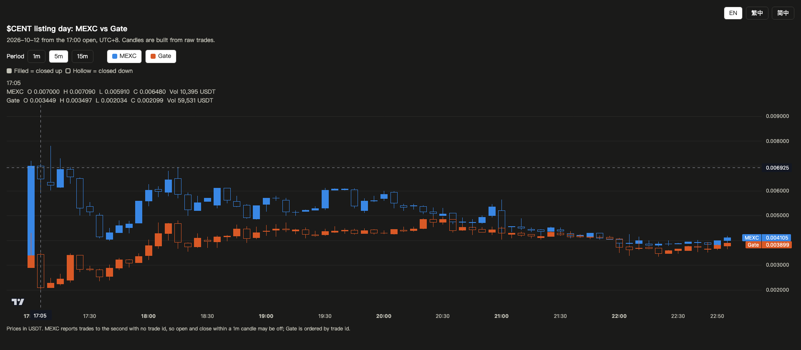

# cent-listing-arb-spread

[English](README.md) | 繁體中文 | [简体中文](README.zh-CN.md)

上幣當天，$CENT 在 MEXC 的價格最高到 Gate 的 3.09 倍。這個 repo 抓下兩所的每一筆成交，畫成並排的 K 線圖。

線上圖表：https://yyu0310.github.io/cent-listing-arb-spread/

給 AI Coding Agent 的提示詞：

> Clone https://github.com/yyu0310/cent-listing-arb-spread ，先讀 AGENTS.md，再跑 fetch_trades.py 和 build_chart.py 重建 index.html。

## 發生了什麼

Incentiv 的代幣 $CENT，在 UTC+8 時區 2026-10-12 17:00 同時在 MEXC 和 Gate 開放現貨交易。以下數字涵蓋 17:00 到 23:00。

| | MEXC | Gate |
|---|---|---|
| 成交筆數 | 10,133 | 32,652 |
| 成交額 | 198,343 USDT | 783,147 USDT |
| 第一筆成交 | 0.0029 | 0.0029 |
| 前 10 分鐘最高 | 0.0072 | 0.0043 |
| 最低 | 0.0029 | 0.002034 |
| 22:59 價格 | 0.004105 | 0.003899 |

- **價差最大時**：17:09 MEXC 收在 Gate 的 3.09 倍。
- **價差 5% 以內**：20:27 之後兩所價格都在 5% 以內。
- **MEXC 開盤第一秒**：10 筆成交時間戳相同，合計 5,555 USDT。

## 兩所的入金鏈

- Gate 的入金頁收的是以太坊上的 ERC-20 版 $CENT
- MEXC 的入金頁收的是 Incentiv 主網上的原生 $CENT
- 兩條鏈的地址都是 0x 開頭，幣要在兩條鏈之間移動得經過跨鏈橋
- 兩所的提幣預計 2026-10-13 左右開放

## 為什麼 K 線用逐筆成交自己算

MEXC 自己的第一根 1 分 K 開盤價寫 0.000725，但成交紀錄裡沒有這個價格，成交最低是 0.0029。這張圖的每一根 K 線都用成交紀錄算，開盤價就是第一個真的有人買到的價格。

## 圖表怎麼用

| 控制 | 作用 |
|---|---|
| 1 分／5 分／15 分 | 切換 K 線週期 |
| MEXC／Gate | 顯示或隱藏某一所 |
| 滑鼠移到圖上 | 看同一時間兩所的開高低收和成交額 |
| EN／繁中／简中 | 切換語言，預設跟著瀏覽器語言 |

每一所一個顏色。實心代表收漲，空心代表收跌。

## 自己重跑

每一步都可以交給 AI Agent 做。不需要帳號或 API key，用的是兩所的公開 API。

1. Python 3.9 以上，只用標準函式庫
2. `python3 fetch_trades.py data`：約 15 秒把所有成交抓進 `data/`，並用兩所的 K 線成交額核對加總
3. `python3 build_chart.py data`：產生 `index.html`
4. 用瀏覽器打開 `index.html`

先用 `mkdir data` 建好資料夾。要研究別的幣，改 `fetch_trades.py` 開頭的交易對和時間區間。

## 檔案

| 檔案 | 用途 |
|---|---|
| `index.html` | 圖表本體，內含 17:00 到 23:00 的資料；GitHub Pages 用它當首頁 |
| `fetch_trades.py` | 從 MEXC 和 Gate 抓成交，並跑成交額核對 |
| `build_chart.py` | 把成交聚合成 1 分 K，填進模板 |
| `chart_template.html` | 頁面版面、三語文字和圖表邏輯 |

## 限制

- MEXC 的成交時間只到秒，也沒有成交編號，同一秒內的先後順序無法確定，1 分 K 的開收盤可能有些微誤差。Gate 的成交照流水編號排序。
- MEXC 同一秒超過 1,000 筆成交時，API 只會給 1,000 筆。發生時 `fetch_trades.py` 的成交額核對會報對不上。
- 公開的成交歷史不一定會一直保留。交易所刪掉舊資料的話，`index.html` 裡的快照還在。
- 本 repo 只記錄這次上幣，交易請自行判斷。

## 授權

MIT。市場資料來自 MEXC 與 Gate 的公開 API。
